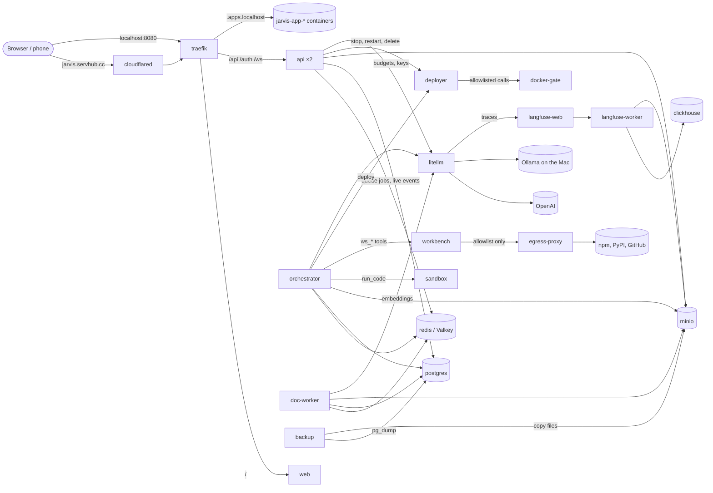

# The containers

`docker compose up -d` starts about 20 containers, all in the Compose project `jarvis`, so
Docker Desktop shows them under one group with names like `jarvis-api-1`. This page says what
each one is for, how they talk to each other, and which ones you can restart or leave out.

## At a glance

| Container | What it is | Needed? | Reachable from your Mac |
| --- | --- | --- | --- |
| `traefik` | Front door: routes every request to the web app or the API | yes | http://localhost:8080 (`JARVIS_HTTP_PORT`) |
| `cloudflared` | Cloudflare Tunnel that publishes Jarvis at https://jarvis.servhub.cc | only for phone / public access (`--profile tunnel`) | no |
| `web` | nginx serving the React app (orb, chat, Library, Admin...) | yes | through Traefik |
| `api` ×2 | FastAPI: sign-in, chats, files, admin, the WebSocket | yes | through Traefik |
| `migrate` | Applies database migrations, then **exits** | runs once per start | no |
| `orchestrator` | Worker that runs Jarvis's turns, agent teams and memory jobs | yes | no |
| `sandbox` | Locked-down box where agents run Python/bash (makes PDFs, Excel...) | for agent code | no |
| `workbench` | Dev teams' workshop: a persistent git folder per project, with Node, Python and a browser | for dev teams | no |
| `egress-proxy` | The workbench's only way out: lets through npm, PyPI and GitHub, nothing else | with the workbench | no |
| `deployer` | Builds finished software projects into containers and runs them as apps | for running apps | no |
| `docker-gate` | The deployer's only door to Docker: a short allowlist of API calls | with the deployer | no |
| `jarvis-app-*` | The apps teams built (made by the deployer, not Compose) | | `<name>.apps.localhost:8080` |
| `doc-worker` | Worker that parses uploads (PDF, Word, PPT, Excel) and indexes them | for documents | no |
| `backup` | Nightly backups of databases and files to `./backups` | recommended | no |
| `postgres` | The main database (with pgvector for search) | yes | 127.0.0.1:5432 |
| `redis` | Valkey: job queues, live events, rate limits, caches | yes | no |
| `minio` | File storage for uploads, generated files and Langfuse events | yes | console at http://localhost:9001 |
| `litellm` | Model gateway: every OpenAI call, per-user budgets, cache | yes | http://localhost:4000 |
| `langfuse-web` | Langfuse UI: traces and cost per call | for observability | http://localhost:3000 (`LANGFUSE_PORT`; 3001 on Shivam's Mac) |
| `langfuse-worker` | Langfuse's background processor | for observability | no |
| `clickhouse` | Analytics database behind Langfuse | for observability | no |

`migrate` showing as **Exited (0)** is normal. Any other container stuck in Exited or
Restarting is a problem; `docker compose logs <service>` shows why.

Ollama is not a container: it runs natively on the Mac (Docker on macOS can't use the GPU) and
LiteLLM reaches it at `host.docker.internal:11434` for embeddings.

## How they fit together



A chat message, end to end:

1. The browser sends it to **traefik**, which hands `/api/...` to one of the **api** replicas.
2. The API saves the message in **postgres** and puts a turn job on a queue in **redis**.
3. The **orchestrator** picks the job up, gathers your memories and documents, and calls the
   model through **litellm** (which forwards to OpenAI and logs the call to **Langfuse**).
4. Reply tokens are published on a redis channel; whichever **api** replica holds your WebSocket
   streams them to the browser.

## Each container in more detail

### Edge

**traefik** (`traefik:v3.6`) is the only container listening beyond the Mac's loopback. It
reads the labels on the other containers to build its routes: `/api`, `/auth` and `/ws` go to the
API, everything else to `web`. It load-balances across the API replicas and stops sending to one
whose `/healthz` fails. It mounts the Docker socket read-only to discover containers. Version 3.6
or newer is required for Docker Engine 29.

**cloudflared** opens an outbound tunnel to Cloudflare, so `https://jarvis.servhub.cc` reaches
Traefik without opening a port on your router. It only starts with
`docker compose --profile tunnel up -d` and needs `CLOUDFLARE_TUNNEL_TOKEN`. Setup:
[infra/cloudflared](../infra/cloudflared/README.md).

### Jarvis itself (built from this repo)

**web** ([apps/web](../apps/web)) is the React + Vite app, built into static files and served
by nginx with the security headers (CSP and friends). It holds no data; rebuilding it is safe.

**api** ([services/api](../services/api)) is the FastAPI backend: Google sign-in and sessions,
chats, uploads, memories, skills, agents, approvals, people, the Admin page and the WebSocket.
It runs `API_REPLICAS` copies (default 2), which is why you see `jarvis-api-1` and
`jarvis-api-2`. Any replica can serve anyone, because sessions, rate limits and live events all
live in Postgres and Valkey.

**migrate** uses the API image to run `alembic upgrade head` against Postgres, then exits.
The API, orchestrator, doc-worker and backup only start after it succeeds, so a new release
brings its database changes with it.

**orchestrator** ([services/orchestrator](../services/orchestrator)) is an arq worker, Jarvis's
"brain". It runs:
- each chat turn (the Jarvis LangGraph graph and its tools),
- agent teams: design, compile, run, pause for approvals, resume,
- memory extraction after each turn and learned-skill drafts,
- every ten minutes, housekeeping; nightly (21:30 UTC, 03:00 IST), memory decay and profile
  rebuilds.

It syncs the core skills from [library](../library) into the database when it starts, and it
is the only container on the `sandbox` network and, with `egress-proxy`, the only other one on
the `workbench` network. `ORCHESTRATOR_REPLICAS` (default 1) adds more.

**sandbox** ([services/sandbox](../services/sandbox)) runs the code agents write with
`run_code` (Python or bash, with pypdf, ReportLab, python-docx, python-pptx, openpyxl, pandas,
matplotlib...). It is deliberately boxed in: an internal network with no internet and no route
to the databases or your LAN, a read-only filesystem with jobs in a 1 GB `/tmp`, all Linux
capabilities dropped, and caps of 3 GB memory, 2 CPUs and 256 processes.

**workbench** ([services/workbench](../services/workbench)) is where dev teams build
software. Each project is a git repository at `/workspaces/<user id>/<project id>` on the
`jarvis_workspaces` volume, so it survives between steps, runs and restarts until it is deleted.
A finished project is pushed from here to its GitHub repo through `egress-proxy`
([GitHub App setup](github-app.md)). Agents use it through the `ws_*` tools: list, read, write and edit files, run a command
(`ws_run`, which needs the exec capability like `run_code`), see the diff and commit. An agent
run works in a project named after the run. The image has Node 22 with npm, Python 3.13 with
uv, git, and Chromium with Playwright (`$PLAYWRIGHT_VERSION`) for headless browser tests.
It is boxed in like the sandbox, with more room for builds:
- its network is internal, and its only way out is `egress-proxy`;
- a read-only root, all Linux capabilities dropped, no new privileges, and caps of 4 GB memory,
  2 CPUs and 1024 processes (threads count, and Chromium and Node use many);
- each command runs with a clean environment (no tokens), CPU-time and file-size limits and a
  wall-clock timeout (`WORKBENCH_TIMEOUT_S`, at most `WORKBENCH_MAX_TIMEOUT_S`) that kills its
  whole process group; anything it leaves running in the background stops when it ends;
- each command is locked to its own project folder with Landlock, so one project can't read or
  change another's. `curl` inside the container shows whether that is on:
  `docker compose exec workbench curl -s localhost:8200/healthz` says `"isolation":
  "landlock v…"`, or `"container"` on a kernel without Landlock.

**egress-proxy** ([infra/egress-proxy](../infra/egress-proxy)) is a tinyproxy that forwards
the workbench's requests to `registry.npmjs.org`, `pypi.org`, `files.pythonhosted.org`,
`github.com`, `codeload.github.com` and `objects.githubusercontent.com` (the list is in
[allowlist](../infra/egress-proxy/allowlist)) and answers anything else with 403. It is the
only container on both the internal `workbench` network and the `egress` network, which has
internet access. `./scripts/check-workbench-net.sh` (part of `./scripts/check.sh`) proves the
box holds: it starts a throwaway copy of the workbench next to Postgres and Redis and checks that
the allowed hosts answer, other sites are refused, and Postgres, Redis, the other Jarvis
services, the Mac, the LAN and the internet can't be reached directly.

**deployer** ([services/deployer](../services/deployer)) runs the apps software teams build. At
the end of a run whose reviewer approved and whose tests passed (or on **Redeploy** on the Apps
page) it builds the project from its workbench folder, mounted read-only, using a house
template ([templates](../services/deployer/src/jarvis_deployer/templates)): a static site on
unprivileged nginx, FastAPI on Python slim, or Express on Node. Agents never write their own
Dockerfiles, and builds have **no network**: they use the `node_modules` or `.venv` the team
installed in the workbench. Each app runs as `jarvis-app-<name>-web` (and `-api` for a back end)
on the `apps` network, replacing the previous version in place: non-root, read-only, 512 MB and
half a CPU, no host folders, restarting unless stopped, and labelled `jarvis.app` and
`jarvis.owner`. Traefik routes `<name>.apps.localhost` to it, and `/api` on that host to the back
end. *.localhost reaches your Mac by itself in Chrome and Firefox, so
`http://2048.apps.localhost:8080` works with no DNS setup; PR 5 moves apps to `servhub.cc` names.
After a start it checks the app answers through Traefik and takes a screenshot with the
workbench image's Playwright; a failed check goes back to the team's builders once, with the
logs, before the reply.

**docker-gate** (same image) is the only container with the Docker socket, and only the deployer
can reach it. Generic socket proxies allow or deny by URL prefix, so allowing containers would
also allow `exec` and file writes into any container; this gate checks every call
([gate.py](../services/deployer/src/jarvis_deployer/gate.py)): offline builds of `jarvis-app-*`
images only; new containers named `jarvis-app-*`, non-root, on the apps network, with memory
and CPU caps and no privileges, host mounts, devices, ports or added capabilities; starting,
stopping, logs and deleting only for containers labelled as Jarvis apps (so not Postgres or any
other Jarvis container); and nothing else: no exec, archive, attach, volumes, swarm or system
calls.

**Apps page** (`/apps`): every app with its owner, state, link, repo and last deploy, and Stop,
Restart, Redeploy and Delete (which removes the containers and image, keeping the project and
repo). The owner sees everyone's apps and can give one internet access (from its next deploy);
members see only their own and can have `MEMBER_APP_LIMIT` (3) running at once. The API enforces
both.

**doc-worker** ([services/doc-worker](../services/doc-worker/README.md)) takes `parse_file`
jobs from the `arq:docs` queue: it parses uploads (Docling for PDFs and images, MarkItDown for
Office files), splits them into chunks, embeds them and stores them for search. Every ten
minutes it embeds anything that was missed while Ollama was off. It is the biggest image (a few
GB, because of Docling and PyTorch); `DOCLING=false` in `.env` builds a small one without OCR.

**backup** ([infra/backup](../infra/backup)) checks every minute for a **Back up now** from the
Admin page and runs the daily backup after `BACKUP_HOUR_UTC` (02:30 IST by default). Each backup
in `./backups` holds a `pg_dump` of the `jarvis`, `litellm` and `langfuse` databases, a tarball
of the MinIO files, the encrypted secrets file (once there is one) and checksums; 14 days are
kept. Restore with `scripts/restore.sh`.

### Data

**postgres** (`pgvector/pgvector:pg17`) holds three databases:
- `jarvis`: users, chats, messages, memories, files and their chunks with vectors, skills,
  agent teams and runs (with checkpoints), the audit log, backups;
- `litellm`: per-user and per-run virtual keys, budgets and spend;
- `langfuse`: Langfuse's users, projects and settings.

The extra two are created by [infra/postgres/init.sql](../infra/postgres/init.sql) the first
time the volume is created.

**redis** runs Valkey (an open-source Redis fork). It is shared plumbing: database 0 holds
Jarvis's job queues (`arq`), the per-user live event channels, rate-limit counters, worker
heartbeats and LiteLLM's response cache; database 1 holds Langfuse's queues. It runs with
`noeviction` because Langfuse's queues must never be dropped. Losing it loses only in-flight
jobs and caches, so it is not backed up.

**minio** is S3-compatible file storage. Bucket `jarvis` holds uploads and files agents make;
bucket `langfuse` holds raw trace events and media for Langfuse.

### Models and tracing

**litellm** (`ghcr.io/berriai/litellm`) is the one door to every model. Jarvis only ever asks
for the aliases in [infra/litellm/config.yaml](../infra/litellm/config.yaml)
(`jarvis-nano`, `jarvis-mini`, `jarvis-pro`, `jarvis-max`, `jarvis-embed`); LiteLLM maps them to
OpenAI models or to bge-m3 in Ollama, enforces each person's budget through their own virtual
key, caches identical calls for an hour and sends every call to Langfuse. It is the only
container that holds `OPENAI_API_KEY`. Point `LITELLM_BASE_URL` elsewhere to use a LiteLLM on
another machine.

**langfuse-web**, **langfuse-worker** and **clickhouse** together are Langfuse v3, the
observability stack: every turn is a `jarvis.turn` trace with each model call, its tokens and
cost. `langfuse-web` is the UI and ingestion API, `langfuse-worker` processes events off the
queue, and `clickhouse` stores the traces for fast querying. ClickHouse is the heaviest
container in the stack; give Docker Desktop at least 8 GB. Jarvis works without these three
(chats still run, traces are just not recorded), and ClickHouse data is not backed up.

## Networks and volumes

- **Networks:** `jarvis_default` connects everything else; `jarvis_sandbox` is internal (no
  internet) and connects only `orchestrator` and `sandbox`; `jarvis_workbench` is internal and
  connects only `orchestrator`, `workbench` and `egress-proxy`; `jarvis_egress` has internet
  access and holds only `egress-proxy`; `jarvis_deployer` (internal) connects the orchestrator,
  the API, Traefik and the deployer; `jarvis_docker-gate` (internal) only the deployer and the gate;
  `jarvis_apps` (internal: no internet, no Jarvis services, no LAN) holds the apps and Traefik;
  `jarvis_apps_egress` is where apps that were given internet access also sit. Apps on
  `jarvis_apps` can reach each other and Traefik's front door, nothing else.
- **Volumes** (where data survives restarts): `jarvis_postgres`, `jarvis_redis`,
  `jarvis_minio`, `jarvis_clickhouse`, `jarvis_clickhouse-logs`, `jarvis_workspaces` (dev-team
  projects; not in the nightly backup, since the code goes to GitHub), plus the `./backups`
  folder.
  `docker compose down` keeps them; `docker compose down -v` **deletes them all**.

## Start-up order

Compose waits on health checks, so things come up in this order:

1. `postgres`, `redis`, `minio`, `clickhouse`, `traefik`, `web`, `egress-proxy`, `docker-gate`
2. `migrate` (after Postgres is healthy), `litellm`, `sandbox`, `workbench`, `deployer`,
   `langfuse-web`, `langfuse-worker`
3. `api`, `orchestrator`, `doc-worker`, `backup` (after `migrate` exits successfully)
4. `cloudflared` (with the tunnel profile)

## Everyday commands

Once the secrets are encrypted (`./scripts/secrets.sh init`, README: Secrets), use
`./scripts/compose.sh` wherever these say `docker compose`; it takes the same arguments.

```sh
docker compose ps                         # what's running, health, ports
docker compose logs -f api orchestrator   # follow logs of a few services
docker compose restart orchestrator       # restart one service
docker compose up -d --build              # rebuild and roll out after git pull
docker compose --profile tunnel up -d     # include the Cloudflare tunnel
docker stats                              # live memory/CPU per container
```

What is safe to restart at any time: `web`, `api`, `traefik` (each a few seconds of downtime),
`backup` and the Langfuse trio. Restarting `orchestrator` cuts off a reply that is mid-stream;
agent runs waiting on an approval or paused are checkpointed in Postgres and carry on. Turn on
maintenance mode on the Admin page before restarting `postgres`, `redis` or `litellm`.

## Where each container gets its settings

All settings come from `.env` through [compose.yaml](../compose.yaml); once encrypted, the
secrets below come from `secrets/jarvis.sops.env` instead, loaded by `./scripts/compose.sh`. The
ones that matter most per container:

| Container | Secrets / key settings |
| --- | --- |
| api, orchestrator, doc-worker, migrate | `SECRET_KEY`, `TOKEN_ENCRYPTION_KEYS`, `POSTGRES_PASSWORD`, `LITELLM_MASTER_KEY`, `MINIO_ROOT_PASSWORD`, `OIDC_CLIENT_ID` / `OIDC_CLIENT_SECRET`, `SANDBOX_TOKEN`, `WORKBENCH_TOKEN`, search and SMTP keys |
| litellm | `OPENAI_API_KEY`, `LITELLM_MASTER_KEY`, `LANGFUSE_PUBLIC_KEY` / `LANGFUSE_SECRET_KEY` |
| langfuse-web, langfuse-worker | `LANGFUSE_SALT`, `LANGFUSE_ENCRYPTION_KEY`, `LANGFUSE_NEXTAUTH_SECRET`, `CLICKHOUSE_PASSWORD`, `LANGFUSE_ADMIN_PASSWORD` |
| postgres, minio, clickhouse, backup | their own passwords from the same `.env` |
| workbench | `WORKBENCH_TOKEN`, `WORKBENCH_MEMORY_MB`, `WORKBENCH_MAX_TIMEOUT_S` |
| deployer, api, orchestrator | `DEPLOYER_TOKEN`, `APPS_DOMAIN`, `APPS_URL`, `MEMBER_APP_LIMIT` |
| orchestrator (GitHub) | `GITHUB_APPS_ORG`, `GITHUB_APP_ID`, `GITHUB_APP_INSTALLATION_ID`, `GITHUB_APP_PRIVATE_KEY_B64` ([setup](github-app.md)) |
| cloudflared | `CLOUDFLARE_TUNNEL_TOKEN` |
